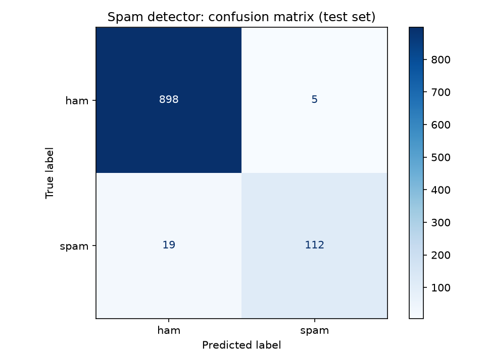

# Spam Detection with NLP and Machine Learning

A machine learning pipeline that classifies messages as **spam** or **ham** (legitimate), plus a **Gmail bot** that uses
the model to classify new emails automatically. Built with **Python**, **NLTK** and **scikit-learn**.



## Results (held-out test set of 1,034 unique messages)

| Model | Accuracy | Spam precision | Spam recall | Legit flagged as spam | Spam missed |
|---|---|---|---|---|---|
| Naive Bayes (alpha = 1.0, untuned) | 96.7% | 99.0% | 74.8% | 1 | 33 |
| **Naive Bayes (alpha = 0.1, tuned) — final model** | **97.7%** | **95.7%** | **85.5%** | **5** | **19** |
| Logistic Regression (balanced) | 97.2% | 87.0% | 91.6% | 18 | 11 |
| Linear SVM (balanced) | 98.1% | 93.0% | 91.6% | 9 | 11 |

**Why Naive Bayes is the final model:** in a spam filter, flagging a real message as spam is usually worse than letting
some spam through. The tuned Naive Bayes wrongly flags only 5 of 903 legitimate messages and gives a confidence score
for each prediction, which the email bot uses. The Linear SVM catches more spam and would be the next step to try
(with calibrated probabilities).

## How it works

```
data/spam.csv -> load_data.py -> clean.py -> train.py -> evaluate.py
                 remove          lowercase,   80/20 split, TF-IDF    accuracy, confusion
                 duplicates      URLs, numbers, (1-2 word phrases),   matrix, model
                                 punctuation,   Naive Bayes with      comparison
                                 stop words,    alpha tuned by 5-fold
                                 stemming       cross-validation
                                                     |
                               predict.py / email_bot.py use models/spam_pipeline.pkl
```

## What I improved after the first version

- **Removed 403 duplicate messages.** The same message could appear in both the training and the test set, which inflates the scores.
- **Fitted the TF-IDF vectorizer on the training data only,** by putting it in a scikit-learn Pipeline. Fitting it on all messages lets test data leak into training.
- **Tuned the Naive Bayes smoothing (alpha) with cross-validation.** Spam recall rose from 74.8% to 85.5%.
- **Compared four models on the same split,** and chose based on the cost of each type of error, not accuracy alone.
- **Moved the email credentials out of the code** into a `.env` file, and the bot no longer replies to spam (replying confirms to spammers that an address is active).

## Run it

```
pip install -r requirements.txt
python load_data.py
python clean.py
python train.py
python evaluate.py
python predict.py "Congratulations! You have won a free prize. Call now to claim"
```

### Optional: the Gmail bot
1. Create a Gmail account for the bot, turn on 2-Step Verification and create an **App Password** at myaccount.google.com/apppasswords.
2. Copy `.env.example` to `.env` and fill in `EMAIL_ADDR` and `EMAIL_PASS`.
3. Run `python email_bot.py`. Every 30 seconds it reads new emails, classifies them, and replies to legitimate ones with the result.

## Dataset

[SMS Spam Collection](https://archive.ics.uci.edu/dataset/228/sms+spam+collection) (Almeida & Gómez Hidalgo, UCI
Machine Learning Repository): 5,572 SMS messages, 5,169 unique, 12.6% spam. Because the model is trained on SMS text,
it works best on short messages. Training on an email corpus would improve the email bot.

## Tools

Python · pandas · NLTK · scikit-learn · matplotlib · imaplib/smtplib

*University ML lab project, COMSATS University Islamabad.*
